# Task 1 — Password Cracking with JTR + Johnny

**Objective:** Crack the passwords of three encrypted PDF files using John the Ripper (JTR), driven through the Johnny GUI.

## Tools Used
- **John the Ripper (JTR)** — the password-cracking engine
- **Johnny** — a GUI front-end for JTR, so attacks can be run point-and-click instead of via command line
- **[onlinehashcrack.com PDF Hash Extractor](https://www.onlinehashcrack.com/tools-pdf-hash-extractor.php)** — used to pull a crackable `$pdf$...` hash out of each locked PDF (the same format `pdf2john` produces)

---

## Step 1 — Launch Johnny and point it at John the Ripper

Johnny itself doesn't crack anything — it just drives the real John the Ripper binary. The first time you open it, it has no path configured yet, so nothing is loaded.

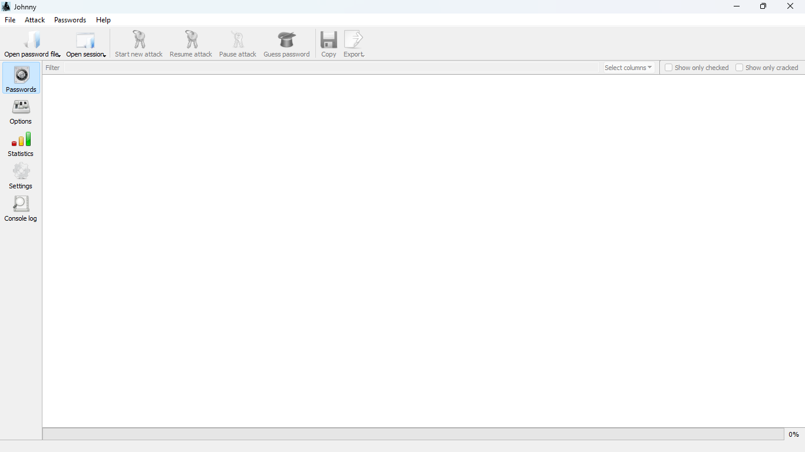

In **Settings**, I browsed to `john.exe` inside the extracted John the Ripper folder so Johnny knows which executable to call.

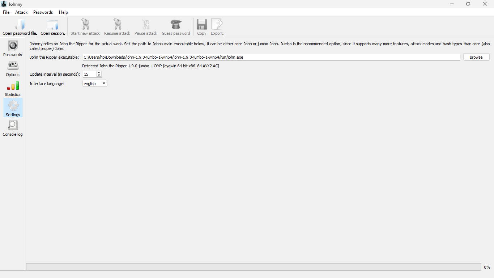

---

## Step 2 — Extract, crack, and verify each PDF

### 🔒 PDF 1

I uploaded the locked PDF to the online hash extractor, which parsed its encryption dictionary and returned a crackable hash in `$pdf$...` format.

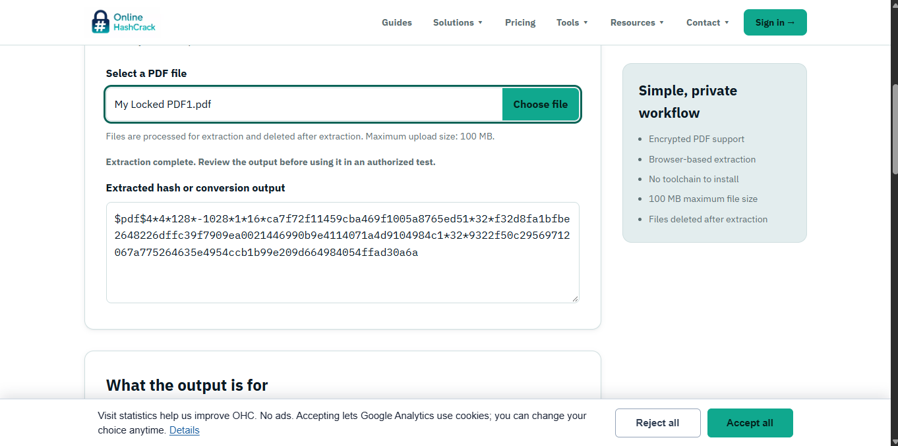

I copied that hash into a plain text file, `hash1.txt`, since that's the format Johnny expects to import.

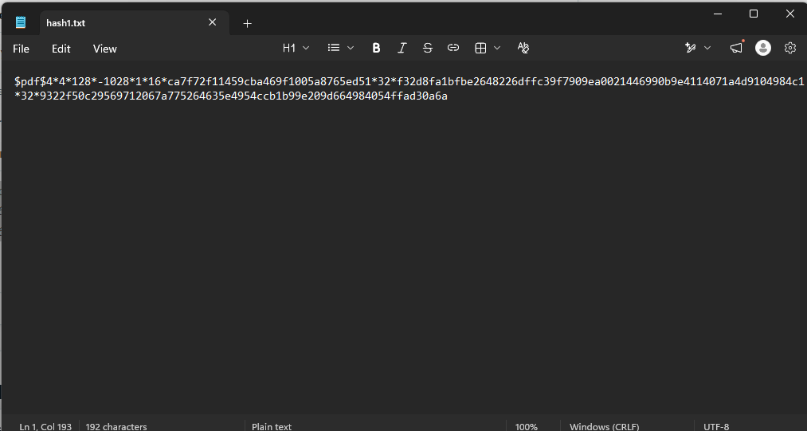

Back in Johnny, I used **Open password file** to load `hash1.txt`. At this point the attack hasn't started yet — 0% cracked.

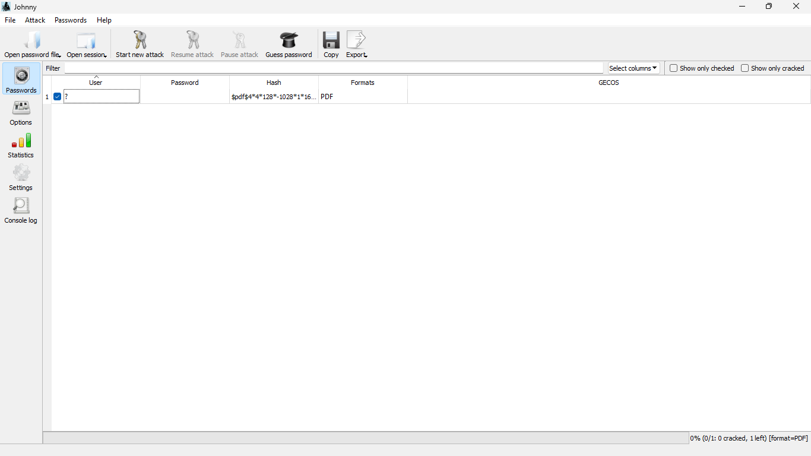

Clicking **Start new attack** ran JTR's default wordlist attack. It found a match almost immediately: the password was `good-luck`.

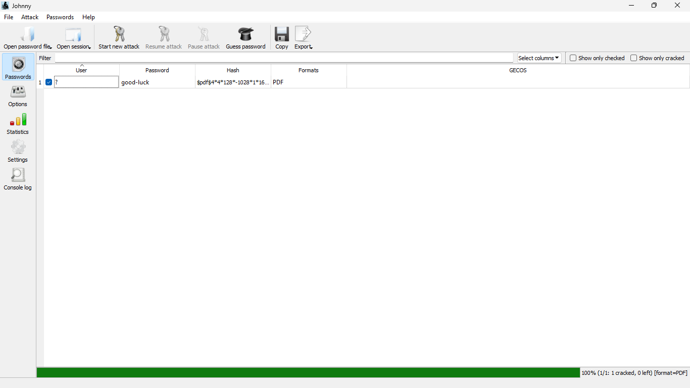

Finally, I opened the PDF and entered `good-luck` to confirm it unlocks — and captured the flag.

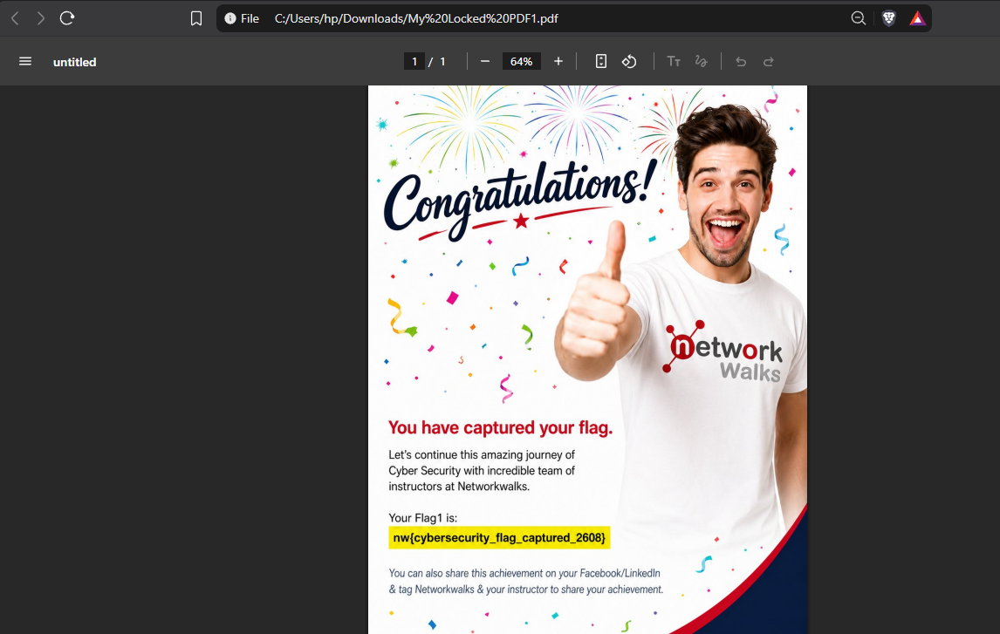

> **Result:** Password = `good-luck` | Flag = `nw{cybersecurity_flag_captured_2608}`

---

### 🔒 PDF 2

Same process repeated for the second PDF — extract the hash:

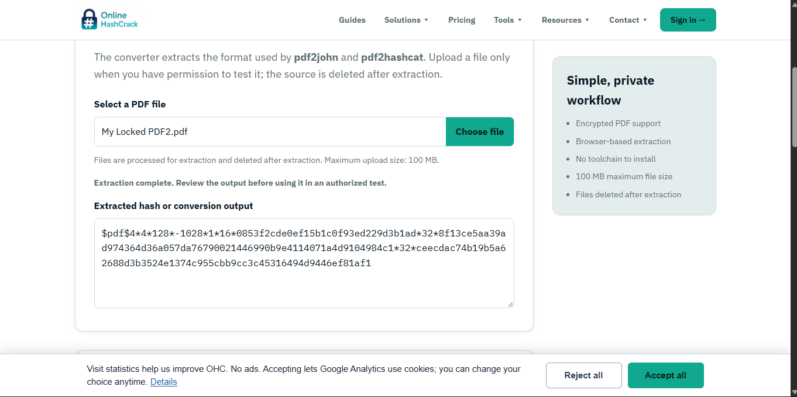

Save it as `hash2.txt`:

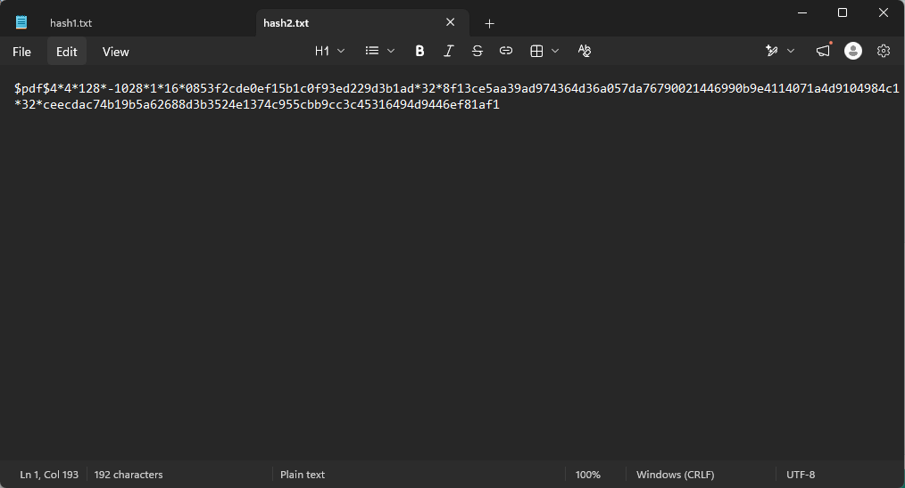

Run the attack in Johnny — this time the password was `password1`, a very common password that gets guessed almost instantly by any wordlist:

Opened the PDF with the cracked password and captured the flag:

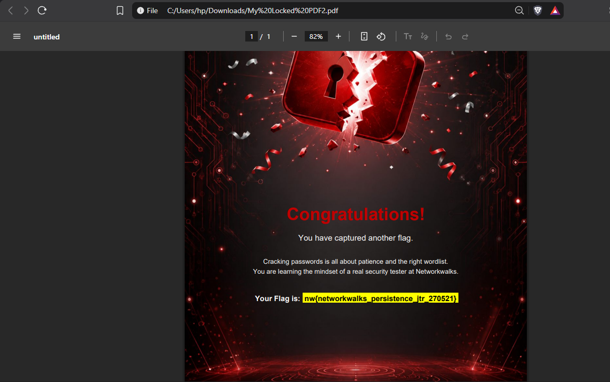

> **Result:** Password = `password1` | Flag = `nw{networkwalks_persistence_jtr_270521}`

---

### 🔒 PDF 3

Extracted the hash for the third PDF:

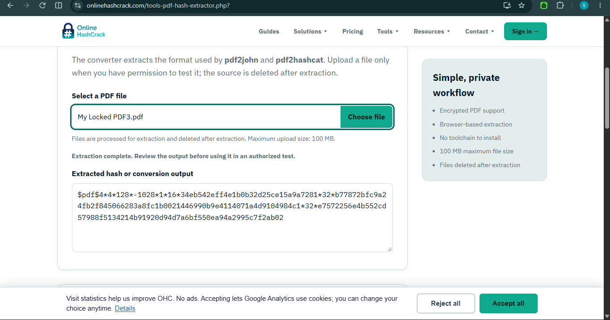

Saved it as `hash3.txt`:

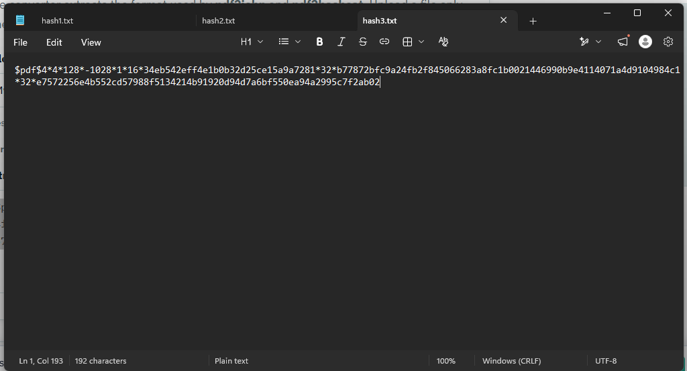

This time the attack took slightly longer since the password was a keyboard-pattern password rather than a dictionary word — JTR cracked it as `1qaz2wsx`:

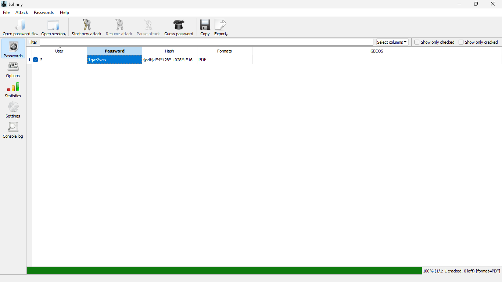

Opened the PDF with the cracked password and captured the final flag:

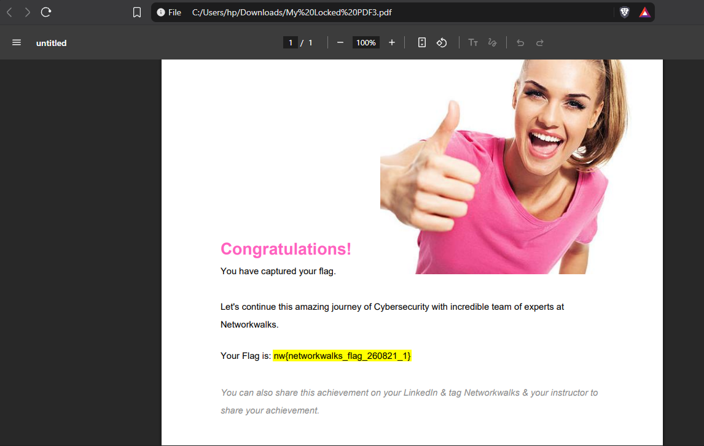

> **Result:** Password = `1qaz2wsx` | Flag = `nw{networkwalks_flag_260821_1}`

---

## 📊 Summary of Results

| PDF | Cracked Password | Flag |
|---|---|---|
| My Locked PDF1.pdf | `good-luck` | `nw{cybersecurity_flag_captured_2608}` |
| My Locked PDF2.pdf | `password1` | `nw{networkwalks_persistence_jtr_270521}` |
| My Locked PDF3.pdf | `1qaz2wsx` | `nw{networkwalks_flag_260821_1}` |

## 🎓 Learning Outcome

All three passwords were cracked in well under a minute because they're all common, dictionary-style, or keyboard-pattern passwords. This is exactly what the lab is designed to show: wordlist attacks are devastatingly effective against predictable passwords, which is why strong, random, unique passwords (and multi-factor authentication) matter so much in practice.
