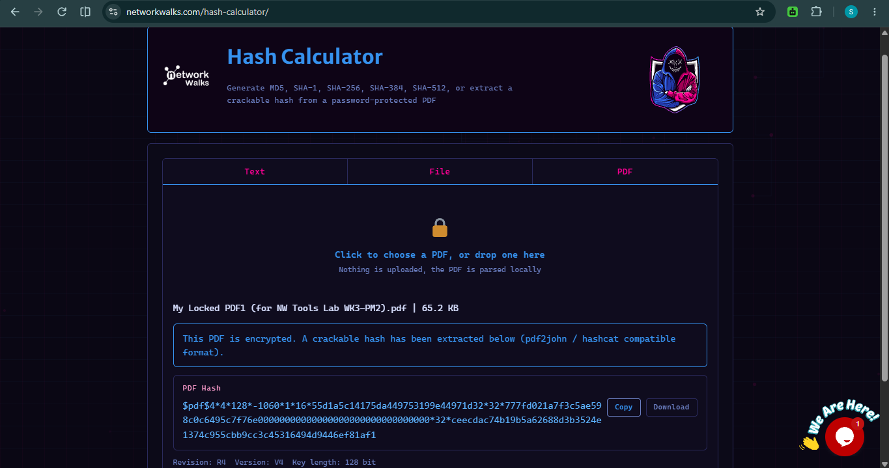
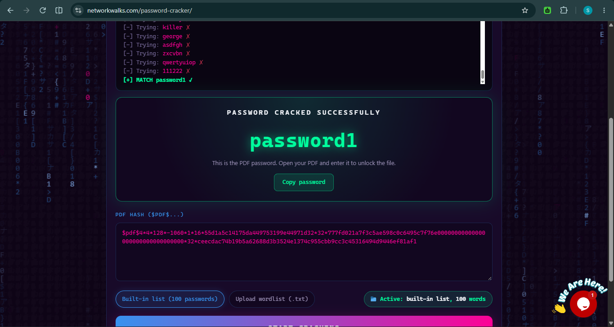
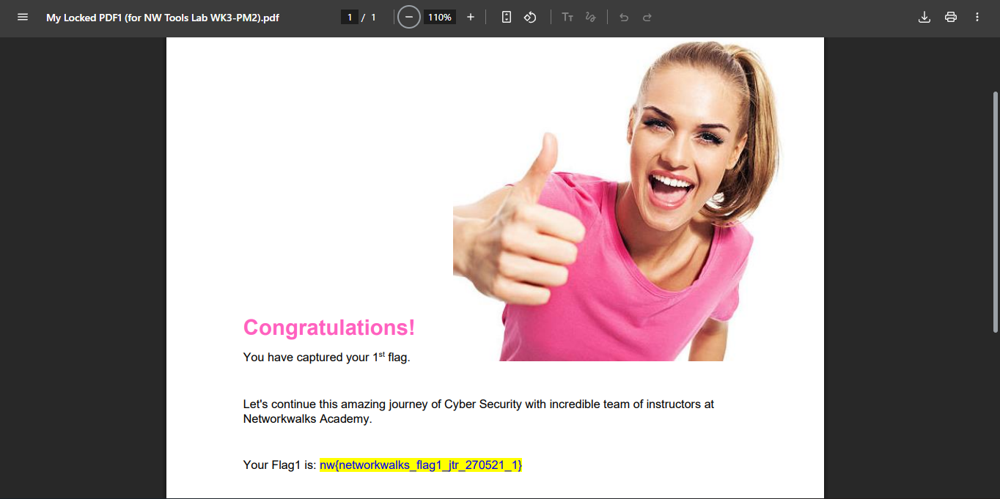

# Task 2 — Password Cracking with Networkwalks Tools

**Objective:** Crack the password of an encrypted PDF using Networkwalks' own free, browser-based tools — no software installation required.

## Tools Used
- **[Networkwalks Hash Calculator](https://networkwalks.com/hash-calculator/)** — extracts a crackable `$pdf$...` hash directly from a locked PDF, parsed entirely in the browser (nothing is uploaded to a server)
- **[Networkwalks Password Cracker](https://networkwalks.com/password-cracker/)** — runs a dictionary attack against that hash using a built-in wordlist

---

## Step 1 — Extract the hash from the locked PDF

I opened the Hash Calculator and uploaded `My Locked PDF1 (for NW Tools Lab WK3-PM2).pdf`. The tool detected it was encrypted and extracted a crackable hash in `pdf2john`/hashcat-compatible format, starting with `$pdf$...`.

I copied the full hash value — making sure to capture it completely, since even one missing character would break the next step.

## Step 2 — Run the dictionary attack

I pasted that hash into the Password Cracker and clicked **Start Cracking**. The tool worked through its built-in 100-word list, trying each candidate against the hash, and found a match: `password1`.

## Step 3 — Verify by opening the PDF

I opened the locked PDF and entered `password1` as the document password — it unlocked immediately, confirming the crack and revealing the flag.

---

## 📊 Result

| PDF | Cracked Password | Flag |
|---|---|---|
| My Locked PDF1 (for NW Tools Lab WK3-PM2).pdf | `password1` | `nw{networkwalks_flag1_jtr_270521_1}` |

## 🎓 Learning Outcome

This task demonstrates the exact same underlying concept as Task 1 (extract hash → dictionary attack → recover password) but through a lightweight, zero-install browser tool. It's a useful option for quick password audits when setting up a full JTR environment isn't practical.
