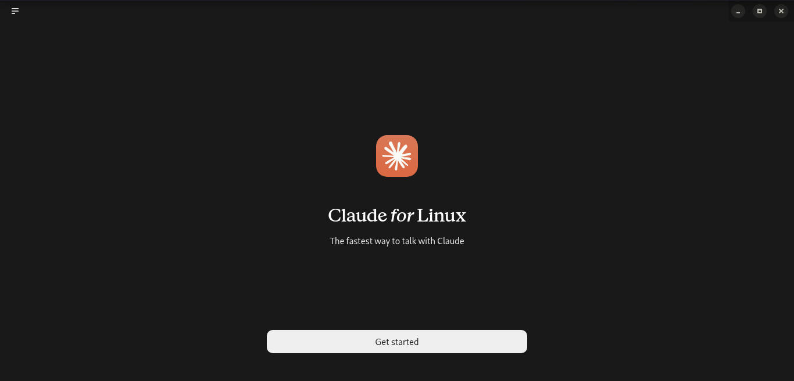
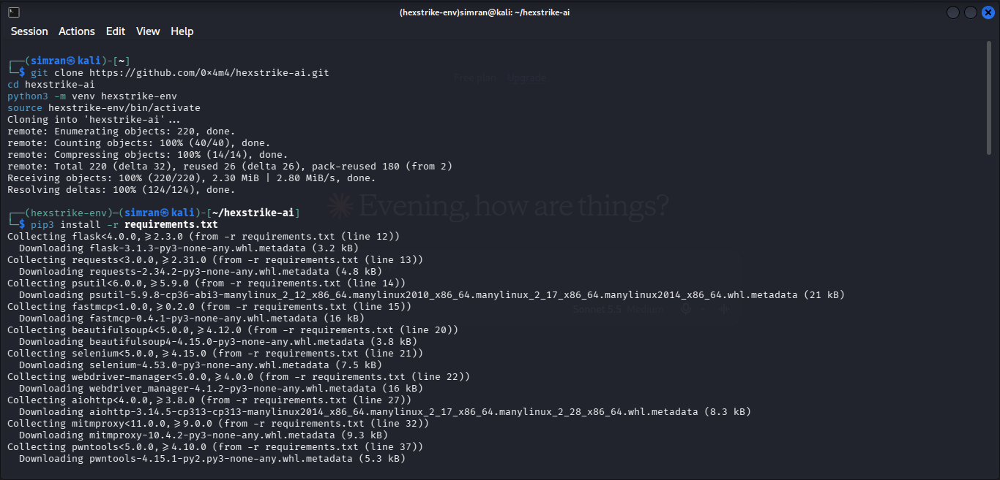
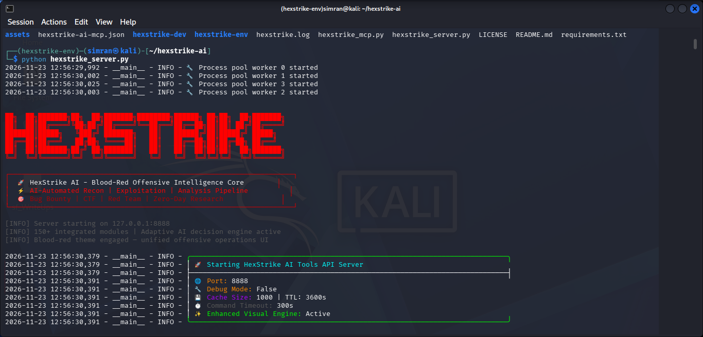
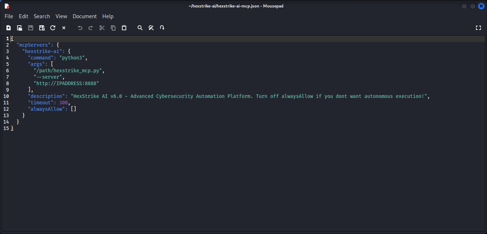
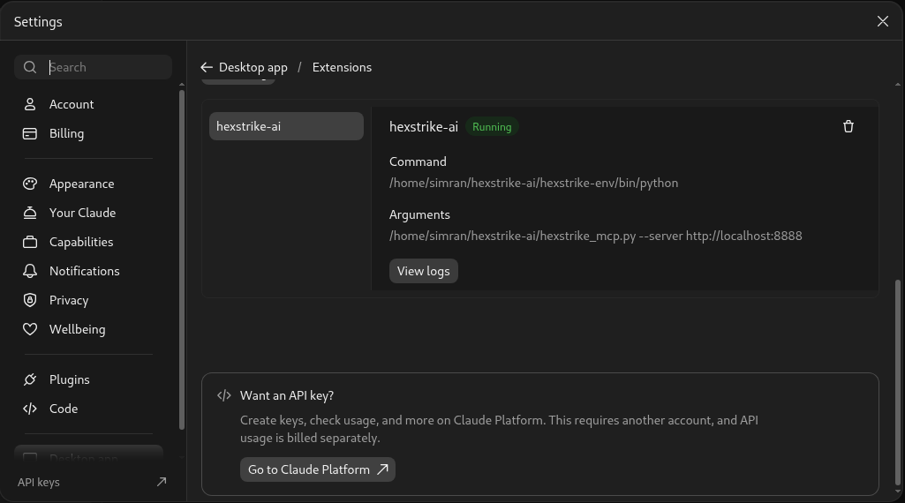
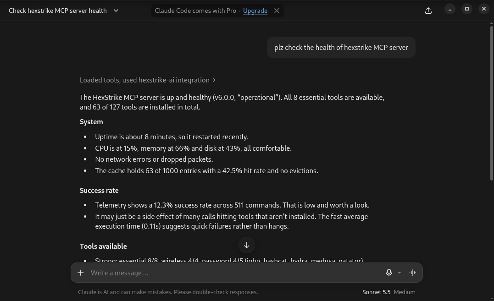
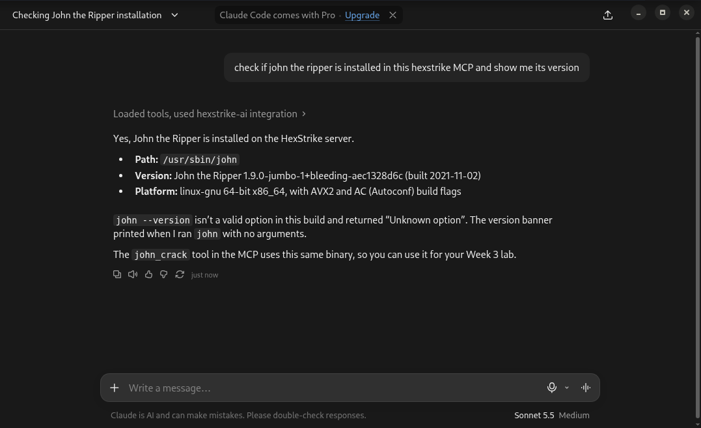
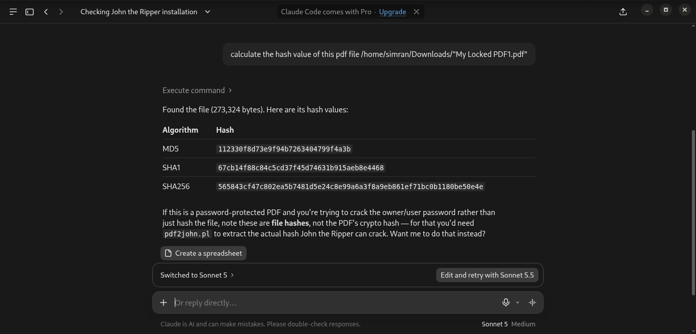
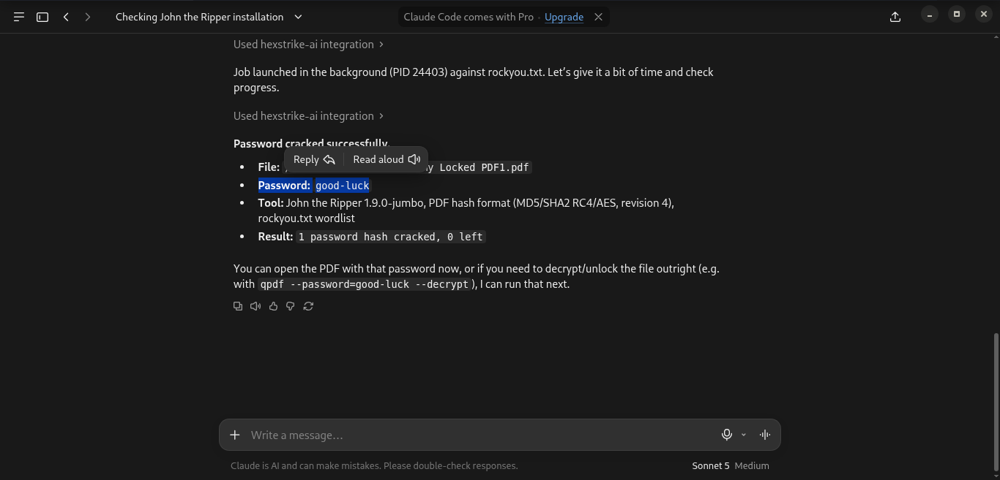

# Task 3 — AI-Assisted Password Cracking with Hexstrike-AI MCP + Claude Desktop

**Objective:** Crack a locked PDF using John the Ripper, but driven entirely through natural-language prompts to Claude Desktop instead of manual commands — by connecting Claude to a self-hosted security-tools MCP server.

## Tools Used
- **Claude Desktop** (Linux) — the AI chat client
- **[Hexstrike-AI](https://github.com/0x4m4/hexstrike-ai)** — an MCP server that exposes offensive-security tools (including JTR) as callable tools for an AI agent
- **John the Ripper** — the actual cracking engine running on the Kali box, called indirectly through Hexstrike
- **rockyou.txt** — wordlist used for the dictionary attack

---

## Step 1 — Install Claude Desktop on Kali

Installed Claude Desktop via the community `aaddrick/claude-desktop-debian` APT repo and completed first launch.

## Step 2 — Clone and set up Hexstrike-AI

Cloned the Hexstrike-AI repo, created a Python virtual environment, and installed its dependencies (Flask, requests, fastmcp, selenium, pwntools, and more).

> **Note:** Along the way, the MCP wrapper failed to start with `ModuleNotFoundError: No module named 'mcp.server.fastmcp'` — the venv had picked up the newer `mcp` 2.x SDK (which renamed `FastMCP`), while `hexstrike_mcp.py` was written against the older 1.x API. Fixed by force-reinstalling an explicit 1.x release (`mcp==1.30.0`) **with its dependencies** directly into the venv's own Python, rather than relying on an activated shell's `pip3`.

## Step 3 — Start the Hexstrike API server

Ran `python3 hexstrike_server.py` in its own terminal — this is the actual tools backend that the MCP wrapper talks to on port 8888. It needs to stay running in the background the whole time.

## Step 4 — Register Hexstrike as an MCP server in Claude Desktop

Added an `mcpServers` entry pointing at the venv's Python and `hexstrike_mcp.py`, with `--server http://localhost:8888`.

After restarting Claude Desktop, Settings → Developer confirmed the connection was live:

## Step 5 — Run the actual cracking workflow via prompts

**Prompt:** *"Please check the health of this hexstrike MCP server"*
Claude reported the server as healthy (v6.0.0, operational), with all 8 essential tools available and 63/127 total tools installed.

**Prompt:** *"Check if John the Ripper is installed in this Hexstrike MCP and show me its version"*
Claude confirmed JTR was installed at `/usr/sbin/john`, version `1.9.0-jumbo-1+bleeding` (built 2021-11-02).

**Prompt:** *"Calculate the hash value of this PDF file: /home/simran/Downloads/My Locked PDF1.pdf"*
Claude returned the file's MD5/SHA1/SHA256 hashes and correctly flagged that cracking the PDF's *open password* needs the `pdf2john`-extracted crack hash rather than a plain file hash.

**Prompt:** *"Use JTR in this Hexstrike MCP server to crack the password of this PDF file using the rockyou.txt wordlist"*
Claude extracted the correct crackable hash, launched John the Ripper against `rockyou.txt`, and reported the password back once the job finished.

---

## 📊 Result

| PDF | Tool Chain | Wordlist | Cracked Password |
|---|---|---|---|
| My Locked PDF1.pdf | Claude Desktop → Hexstrike-AI MCP → John the Ripper 1.9.0-jumbo | rockyou.txt | `good-luck` |

## 🎓 Learning Outcome

This task shows the same password-cracking fundamentals as Tasks 1 and 2 (extract hash → dictionary attack → recover password), but demonstrates how an MCP server turns command-line security tools into something an AI agent can operate conversationally — checking tool versions, calculating hashes, and running JTR attacks purely from natural-language prompts instead of typed commands. It's also a good lesson in environment troubleshooting: a mismatched Python package version (`mcp` 2.x vs. the 1.x API the script expected) was enough to silently break the whole integration until diagnosed and pinned correctly.
